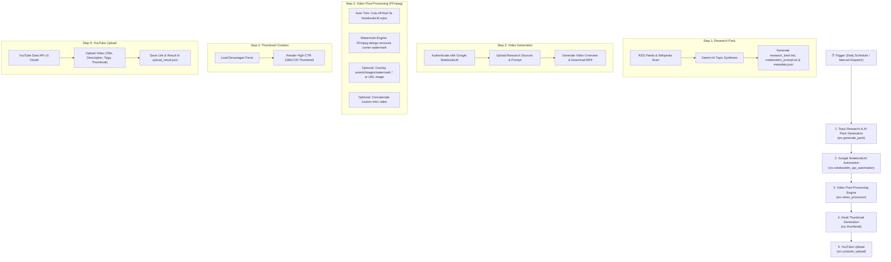

# 🎬 YouTube Automation Pipeline (NotebookLM Video Overview)

An end-to-end automated YouTube content engine that discovers trending topics, creates AI research packs, generates high-quality videos using **Google NotebookLM Video Overviews**, post-processes the video (removes watermarks, trims outros, attaches intros), generates Hindi thumbnails, and automatically uploads directly to YouTube.

Can be run **100% in the cloud via GitHub Actions (No PC required)** or locally on your machine.

---

## 📑 Table of Contents
1. [Overview & Core Rule](#-core-rule)
2. [Step-by-Step Pipeline Flow](#-step-by-step-pipeline-flow)
3. [Key Features & Post-Processing](#-key-features--post-processing)
4. [Execution Modes (Auto vs Custom)](#-execution-modes-auto-vs-custom)
5. [Setup & Configuration Guide](#-setup--configuration-guide)
   - [A. Google Cloud & YouTube API](#a-google-cloud--youtube-api-setup)
   - [B. NotebookLM Authentication](#b-notebooklm-authentication)
   - [C. GitHub Actions Secrets](#c-github-actions-secrets)
6. [How to Run](#-how-to-run)
   - [Method 1: 100% Cloud (GitHub Actions)](#method-1-100-cloud-github-actions---recommended)
   - [Method 2: Local PC Execution](#method-2-local-pc-execution)
7. [Assets & Watermark Customization](#-assets--watermark-customization)
8. [Project Structure](#-project-structure)

---

## 📌 Core Rule
> **Non-negotiable Video Rule:** The final video is generated exclusively by **Google NotebookLM Video Overview**. This repository does not use third-party AI video avatars; it automates NotebookLM directly to produce cinematic, research-backed video overviews.

---

## 🔄 Step-by-Step Pipeline Flow



---

## 🚀 How Each Step Works (Step-by-Step Explanation)

### **Step 1: AI Topic Research & Research Pack Generation** (`src/generate_pack.py`)
- **What it does:** Scans top agricultural and farming RSS feeds (Google News, Krishi Jagran) and Wikipedia topics.
- **In Auto Mode:** Gemini AI analyzes current trending topics, selects the most engaging subject for Indian farmers/viewers, and creates:
  - `research_brief.md`: Detailed factual brief tailored for NotebookLM ingestion.
  - `notebooklm_prompt.txt`: Optimized prompt directing NotebookLM to create an explainer video overview in Hindi.
  - `metadata.json`: YouTube Title, Description (with timestamps & hashtags), SEO Tags, and Thumbnail catchphrase.
- **In Custom Mode:** Accepts your custom topic via input (e.g. *Polyhouse Farming Guide*).

### **Step 2: Google NotebookLM Video Overview Generation** (`src/notebooklm_api_automation.py`)
- **What it does:** Connects to Google NotebookLM using authenticated session credentials (Master Token or storage state).
- Creates a new notebook, injects the generated research sources and prompt, and triggers **Generate Video Overview**.
- Polls the generation status until the cinematic video is rendered and downloads the MP4 to `output/notebooklm/notebooklm_video.mp4`.

### **Step 3: Video Post-Processing Engine** (`src/video_processor.py`)
- **Auto Outro Trimming**: In `auto` mode, detects video duration using `ffprobe` and cuts off the last **3 seconds** of the video to remove NotebookLM's default concluding screen (`"Made with NotebookLM"`).
- **Watermark Removal (`delogo`)**: Automatically removes the NotebookLM watermark badge in the bottom-right corner using FFmpeg spatial interpolation (`delogo`).
- **Custom Branding Replacement**:
  - If you put an image in `assets/images/` named `watermark.*` (or provide a URL via `custom_watermark_url`), the pipeline removes the watermark and overlays your custom logo in that exact spot.
  - If **no image** is provided, the watermark stays cleanly removed with no replacement image added.
- **Intro Video (Optional)**: If you provide an intro video link, it seamlessly merges your intro before the main video, standardizing 1080p resolution and stereo audio.

### **Step 4: High-CTR Hindi Thumbnail Generation** (`src/thumbnail.py`)
- **What it does:** Generates a YouTube-compliant 1280x720 thumbnail with Devanagari Hindi text rendering (using fonts like `NotoSansDevanagari-Bold.ttf`, `Mukta-Bold.ttf`, `Baloo2-Bold.ttf`).
- Uses high-contrast backgrounds, badge accents, and catchy text from `metadata.json`.
- Can be overridden by supplying a direct link via `custom_thumbnail_url`.

### **Step 5: Automated YouTube Upload** (`src/youtube_upload.py`)
- **What it does:** Authenticates securely with the YouTube Data API v3 using OAuth refresh tokens.
- Uploads the processed MP4 video along with:
  - SEO Title (max 100 chars)
  - Full Description with hashtags & attribution (max 5000 chars)
  - Search Tags (max 30 tags)
  - Category ID (default: 27 - Education)
  - Custom Thumbnail image
- Defaults to `private` privacy status so you can review before publishing publicly.
- Outputs the YouTube URL and video ID to `output/upload_result.json`.

---

## 🎛️ Execution Modes (Auto vs Custom)

| Feature | Auto Mode (`mode: auto`) | Custom Mode (`mode: custom`) |
| :--- | :--- | :--- |
| **Topic Selection** | Fully automatic via RSS/Wikipedia/Gemini | Custom topic specified by you |
| **Outro Trimming** | **Automatically trims last 3 seconds** | Trims only if `custom_trim_start` / `custom_trim_end` provided |
| **Watermark Removal** | **Active (FFmpeg delogo)** | **Active (FFmpeg delogo)** |
| **Watermark Image** | Uses `assets/images/watermark.*` if present | Uses `assets/images/watermark.*` or `custom_watermark_url` |
| **Schedule Support** | Runs daily at 09:00 IST via cron | Triggered manually via `workflow_dispatch` |
| **YouTube Metadata** | Auto-generated by AI | Can be customized via inputs or auto-generated |

---

## ⚙️ Setup & Configuration Guide

### A. Google Cloud & YouTube API Setup
1. Go to the [Google Cloud Console](https://console.cloud.google.com/) and create a new project.
2. Enable the **YouTube Data API v3**.
3. Create an **OAuth 2.0 Client ID** (Application type: Desktop App).
4. Download the client secret JSON file and save it as `client_secret.json` in your local project root (never commit this file).
5. Generate your permanent YouTube refresh token:
   ```bash
   pip install -r requirements.txt
   python scripts/get_youtube_refresh_token.py --client-secrets client_secret.json
   ```
6. Save the generated `refresh_token`, `client_id`, and `client_secret`.

---

### B. NotebookLM Authentication

To enable NotebookLM generation in GitHub Actions without passwords expiring:

#### Option 1: Master Token (Recommended - Permanent, Never Expires)
1. Run the local master token setup script on your computer:
   ```powershell
   python scripts/setup_master_token.py
   ```
2. Follow the on-screen prompt to log in once.
3. This creates a JSON token string. Copy the output.
4. Add it as a GitHub Actions secret named **`NOTEBOOKLM_MASTER_TOKEN_JSON`**.

#### Option 2: Cookie Session State (`storage_state.json`)
1. Run the login script:
   ```powershell
   python scripts/notebooklm_login.py
   ```
2. Log into your Google account in the browser that opens.
3. Once logged in, press Enter in your terminal. This creates `storage_state.json`.
4. Copy the file contents and save it in GitHub Secrets as **`NOTEBOOKLM_AUTH_JSON`**.

---

### C. GitHub Actions Secrets

Add these secrets in **GitHub Repository → Settings → Secrets and variables → Actions**:

| Secret Name | Required | Description |
| :--- | :---: | :--- |
| `NOTEBOOKLM_MASTER_TOKEN_JSON` | **Yes** (or AUTH_JSON) | Permanent Master Token for NotebookLM authentication |
| `NOTEBOOKLM_AUTH_JSON` | Optional | Browser cookie state fallback |
| `YOUTUBE_CLIENT_ID` | **Yes** | Google Cloud OAuth Client ID |
| `YOUTUBE_CLIENT_SECRET` | **Yes** | Google Cloud OAuth Client Secret |
| `YOUTUBE_REFRESH_TOKEN` | **Yes** | OAuth 2.0 Refresh Token for YouTube Uploads |
| `GEMINI_API_KEY` | Optional | Google Gemini API Key for high-accuracy metadata generation |

---

## 💻 How to Run

### Method 1: 100% Cloud (GitHub Actions) - Recommended
1. In your GitHub repository, navigate to the **Actions** tab.
2. Select **Full NotebookLM Pipeline (100% Cloud Server - No PC Required)**.
3. Click **Run workflow**:
   - **Mode**: Choose `auto` (fully automated) or `custom`.
   - **Custom Topic** *(optional)*: E.g., `ड्रिप सिंचाई तकनीक और फायदे`.
   - **Custom Watermark URL** *(optional)*: Direct link or Google Drive link to your logo.
   - **Custom Intro URL** *(optional)*: Link to an MP4 intro video.
   - **Upload Privacy**: `private`, `unlisted`, or `public`.
4. The workflow will execute in the cloud, post-process the video, and upload it to YouTube!

### Method 2: Local PC Execution
Run the complete pipeline locally using PowerShell:
```powershell
# 1. Clone repository
git clone https://github.com/saurabhdevworks-code/yt-automate.git
cd yt-automate

# 2. Install dependencies
pip install -r requirements.txt
playwright install chromium

# 3. Create .env with credentials
# YOUTUBE_CLIENT_ID=...
# YOUTUBE_CLIENT_SECRET=...
# YOUTUBE_REFRESH_TOKEN=...
# GEMINI_API_KEY=...

# 4. Run the pipeline
.\run_local_pipeline.ps1
```

---

## 🎨 Assets & Watermark Customization

### Watermark Removal & Replacement Rules:
- **Default behavior**: The NotebookLM corner watermark is **always removed** using FFmpeg `delogo`.
- **To add your own logo / watermark image**:
  - Place your image inside [`assets/images/`](assets/images/) named **`watermark`** (supported: `watermark.png`, `watermark.jpg`, `watermark.webp`).
  - Or supply a URL in GitHub Actions using `custom_watermark_url`.
- **If no image is added in `assets/images/`**:
  - The watermark is simply removed cleanly via `delogo` without any replacement image added.

### Thumbnail Fonts:
Devanagari fonts are pre-configured in [`assets/fonts/`](assets/fonts/):
- `NotoSansDevanagari-Bold.ttf`
- `Mukta-Bold.ttf`
- `Hind-Bold.ttf`
- `Baloo2-Bold.ttf`
- `Poppins-Bold.ttf`

---

## 📂 Project Structure

```text
yt-automate/
├── .github/workflows/
│   ├── full-pipeline-cloud.yml       # 100% Cloud GitHub Actions workflow
│   ├── full-pipeline-self-hosted.yml # Windows self-hosted runner workflow
│   ├── research.yml                  # Standalone research pack generator
│   └── upload.yml                    # Standalone video uploader
├── assets/
│   ├── fonts/                        # Devanagari TTF fonts for thumbnails
│   └── images/                       # Folder for custom watermark image (watermark.png)
├── config/
│   ├── channel_context.json          # Channel persona & context prompt
│   └── settings.json                 # Channel configuration & post-processing settings
├── scripts/
│   ├── get_youtube_refresh_token.py  # Local tool to generate YouTube OAuth token
│   ├── notebooklm_login.py           # Cookie capture tool
│   └── setup_master_token.py         # Permanent Master Token generator
├── src/
│   ├── generate_pack.py              # AI Research & prompt generator
│   ├── notebooklm_api_automation.py  # Cloud NotebookLM client
│   ├── notebooklm_automation.py      # Playwright browser automation
│   ├── thumbnail.py                  # Hindi thumbnail generator
│   ├── video_processor.py            # FFmpeg: delogo watermark removal, 3s trim, intro concat
│   └── youtube_upload.py             # YouTube Data API uploader
├── tests/
│   ├── test_core.py                  # Metadata & cookie tests
│   └── test_video_processor.py       # Unit tests for trim, delogo & watermark detection
├── run_local_pipeline.ps1            # Local execution script (Windows PowerShell)
├── requirements.txt                  # Python dependencies
└── README.md                         # Project documentation
```

---

## 🔒 Security Best Practices
- Never commit `.env`, `client_secret.json`, `token.json`, or browser cookies to git.
- The `.gitignore` is pre-configured to prevent sensitive credentials and tokens from being committed.
- Default upload privacy is set to `private` to allow manual verification before videos go public.
